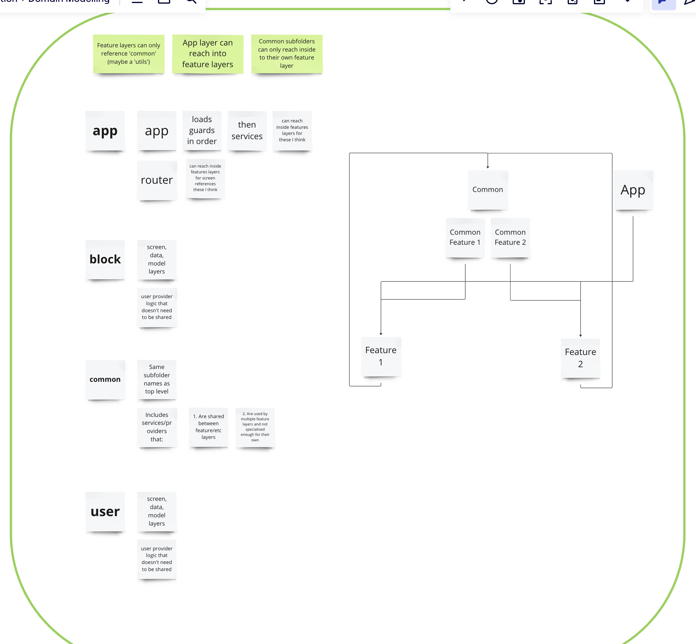

# Architecture

## UPDATE as of 2024-05-01

Miro has an updated architecture plan:

## State context layers

### References

* Riverpod discussion on [why providers need to be connected to widgets](https://github.com/rrousselGit/riverpod/issues/238).

### Principles

To reduce state complexity, providers and loader widgets are grouped into context layers.

Some principles:

* **Data flows inwards.**
  * E.g. user context (inner) needs environment context (outer) to know which server URL to use.
* **Dependencies and operations flow outwards.**
  * E.g. User context (inner) can depend on environment context (outer), not the other way around.
  * E.g. Workspace context (inner) can add an import request to the user context's importer (outer). The opposite -- the user context (outer) operating on the workspace context (inner) -- should not happen.
* **Group similar, coupled state.**
  * E.g. The PocketBase instance needs to change whenever the user changes, so it goes in the user context layer.
* **Sync access for blocking, async state.**
  * E.g. Getting the user's saved theme from secure storage is async but needed for MaterialApp, so the app context layer will ensure it is fetched before rendering inner layers (including the MaterialApp) and expose a synchronous provider.
